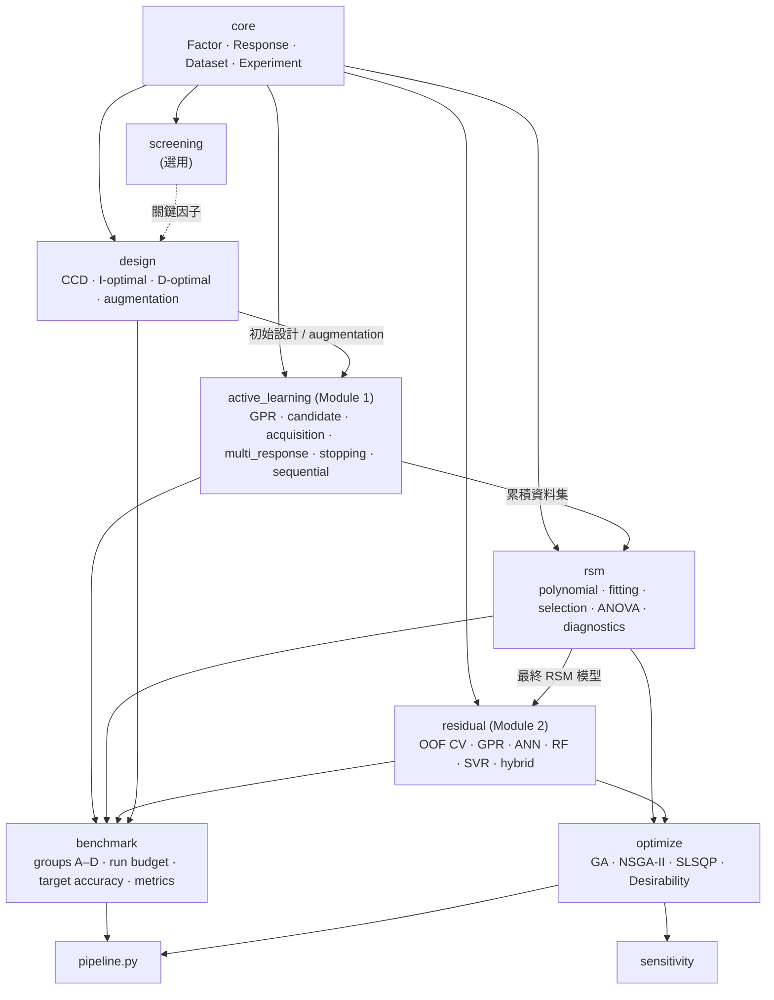
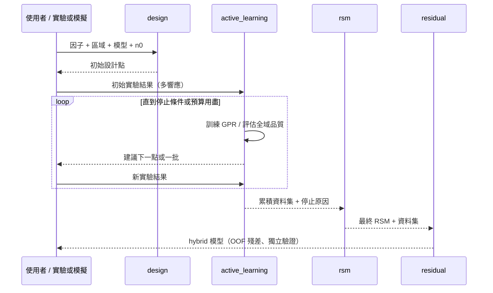

# ADoRE 架構

> 狀態：設計文件。下列模組、介面皆為**規劃**，除 `adore/__init__.py` 外尚未實作。
> 介面為「契約草案」，將在對應開發階段定案；定案前可能修改。

## 1. 整體架構圖

**硬性依賴規則**

| 規則 | 說明 |
|---|---|
| `active_learning` 只可依賴 `core`、`design` | 不得 import `rsm`、`residual`（Module 1 可獨立執行） |
| `residual` 透過 `core` 的介面接收「基底模型」 | 只需要 fit / predict，因此可獨立於 Module 1；且不是 Module 1 的前置條件 |
| `benchmark` 是唯一可整合所有研究模組的層 | 其他模組不得反向依賴 `benchmark` |
| `optimize` 只作用於已驗證的最終預測模型 | GA 不進入 `active_learning` |
| `screening` 為選用 | 已知關鍵因子時可直接進入 `design` |

## 2. 模組職責

| 模組 | 職責 | 不負責 |
|---|---|---|
| `core` | 因子、響應、資料集、實驗紀錄、座標編碼（natural ↔ coded） | 任何統計建模 |
| `screening` | PB、Fractional Factorial、主效應 / Pareto / half-normal | RSM 設計 |
| `design` | CCD、I-/D-optimal、augmentation、候選集與約束區域處理 | 以 GPR 不確定度做選點 |
| `active_learning` | GPR 代理、候選點、acquisition、多響應聚合、停止條件、序貫迴圈 | 最終 RSM 建模、殘差修正 |
| `rsm` | 多項式模型、stepwise、AICc/BIC、hierarchy、ANOVA、LOF、診斷 | 實驗點選擇 |
| `residual` | OOF 殘差目標、殘差模型、hybrid 預測 | 取代 RSM 方程式 |
| `benchmark` | 四組實驗、固定預算 / 目標準確度比較、指標、多種子彙整 | 演算法本身 |
| `optimize` / `sensitivity` | 最終參數最佳化與敏感度分析 | 實驗設計 |

## 3. 資料流

停止原因必須是明確列舉值，例如 `target_reached`、`budget_exhausted`（目標未達成）。

## 4. Module 1 與 Module 2 的分離

- Module 1 的輸入只有「設計 + 實驗資料」，輸出是「建議點 + 歷程 + 累積資料集」。
- Module 2 的輸入是「資料集 + 一個提供 fit/predict 的基底模型（通常是最終 RSM）+ 獨立驗證資料」。
- 兩者之間唯一的資料交接物是 **`ExperimentDataset`**，不共享模型物件。
- 分離的後果：Module 1 的 GPR 代理與最終 RSM 是**不同模型**，達成 GPR 的預測目標不保證 RSM 也達標
  （見 `research_methodology.md` §9）。

## 5. 核心資料契約（草案）

| 物件 | 必要欄位 / 行為 |
|---|---|
| `Factor` | name, low, high, unit；natural ↔ coded 轉換（預設 coded 範圍 [−1, 1]） |
| `Response` | name, 可選 weight、可選 R² 門檻、方向（供最佳化使用） |
| `ExperimentDataset` | X（natural 與 coded）、每個響應的 y、run_id、來源標籤（initial / AL iteration / validation）、seed 與設計 metadata；各響應共用同一組 X |
| `Design` | 設計點、method、criterion、model spec、seed、診斷（rank、condition number） |
| `Surrogate`（protocol） | `fit`、`predict(return_std)`、可在固定超參數下評估「假設加入某點後」的變異（供 IVR） |
| `Acquisition`（protocol） | 輸入候選集、代理模型狀態、評估集與響應權重 → 每個候選點的分數 |
| `StoppingRule`（protocol） | 輸入歷程 → `StopDecision(stop, reason, per_response_status)` |
| `ResidualCorrector`（protocol） | 輸入基底模型 + 資料 + CV 設定 → hybrid predictor；必須使用 OOF 殘差 |
| `BenchmarkGroup` | design strategy × final model；共用 initial design、validation set、seed、budget |

## 6. 擴充點

- 新代理模型：實作 `Surrogate`（例如 GPR 之外的模型），不修改 acquisition 與 stopping。
- 新 acquisition：實作 `Acquisition`，需聲明如何處理多響應正規化。
- 新殘差模型：實作 `ResidualCorrector` 所需的 regressor 介面（fit / predict）。
- 新停止條件：實作 `StoppingRule`，可組合（所有條件 AND）。
- 新 benchmark 群組：以 design strategy 與 final model 的組合描述。

## 7. 從舊 repo 結構的對應

見 [`repository_audit.md`](repository_audit.md) §3。
